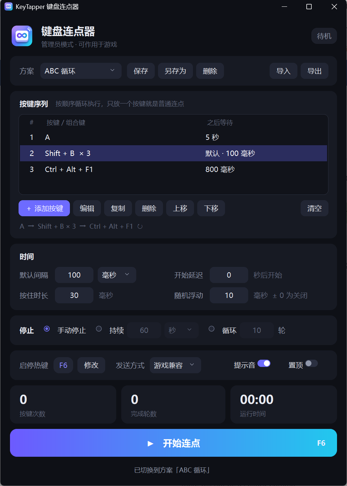

<div align="center">


# KeyTapper 键盘连点器

一个界面简洁的 Windows 键盘连点器：单键连点、组合键、多步循环序列，在游戏和其他程序里同样生效。




</div>

## 功能

- **单键 / 组合键连点**：直接按下想要的键来录制，支持 `Shift + A`、`Ctrl + Alt + F1` 这类组合，也可以选鼠标左 / 右 / 中键。
- **多步循环序列**：例如 `A → B → C → 回到 A`，每一步可以单独设置等待时间，不设置就用默认间隔。
- **连按次数**：每一步可以连按 N 次再进入下一步。
- **时间控制**：间隔支持毫秒 / 秒 / 分钟，可设置开始延迟、按住时长、随机浮动。
- **停止条件**：手动停止、持续指定时长后停止、循环指定轮数后停止。
- **全局热键**：默认 `F6` 启停，可改成其他键或组合键，在任何窗口里都有效。
- **游戏兼容**：以管理员身份运行，并用硬件扫描码发送按键。
- **方案管理**：把一套设置保存为命名方案，随时切换；可以导出成 `.json` 文件分享给别人，对方导入即可使用。
- **运行数据**：实时显示按键次数、完成轮数、运行时间和进度，开始 / 停止有提示音。

## 环境要求

- Windows 10 或 Windows 11
- Python 3.8 及以上（需要自带 tkinter，python.org 的安装包和 Anaconda 都自带）
- [Pillow](https://python-pillow.org/)

## 安装

```bash
git clone https://github.com/liliyawanttosleep/KeyTapper.git
cd KeyTapper
pip install -r requirements.txt
```

## 启动

任选一种方式：

- 双击 `启动连点器.bat`
- 或者在命令行运行：

  ```bash
  pythonw keytapper.py
  ```

启动时 Windows 会弹出权限确认框，请点「是」。程序需要管理员权限才能把按键发送到以管理员身份运行的游戏；如果点了「否」，程序仍会以普通权限打开，只是在这类游戏里不生效。

想要桌面快捷方式的话，运行一次：

```bash
powershell -ExecutionPolicy Bypass -File create_shortcut.ps1
```

## 使用方法

### 普通连点

1. 点「＋ 添加按键」，再点「录制按键」，按下想要的键，点「确定」。
2. 在「时间」里设置默认间隔。
3. 按 `F6`（或点「开始连点」）开始，再按一次停止。

按键会发送到**当前最前面的窗口**，所以开始后切换到游戏或其他程序即可。

### 循环序列

以「按 A，5 秒后按 B，再 5 秒后按 C，再 5 秒回到 A」为例：

1. 把默认间隔设为 `5`，单位选「秒」。
2. 依次添加按键 `A`、`B`、`C`。
3. 按 `F6` 开始。

如果各步的等待时间不同，添加或编辑按键时选「自定义」并填入该步之后的等待时间。

### 各项设置的含义

| 设置 | 说明 |
| --- | --- |
| 默认间隔 | 每按一次之后等待多久再按下一次，最小 1 毫秒 |
| 开始延迟 | 按下开始后先倒计时多少秒，方便切换窗口 |
| 按住时长 | 每次按下保持多久再松开；游戏漏键时可调到 50–80 毫秒 |
| 随机浮动 | 让间隔在 ± 若干毫秒内随机变化，0 为关闭 |
| 停止 | 手动停止 / 持续一段时间 / 循环若干轮 |
| 启停热键 | 全局生效，不能和要连点的按键相同 |
| 发送方式 | 「游戏兼容」用扫描码发送，适合大多数游戏；个别程序不识别时换「普通」 |

### 方案的保存与分享

- 「保存 / 另存为」：把当前的按键序列、时间和停止条件存成一个方案，之后在下拉框里切换。
- 「导出」：生成一个 `.json` 文件，发给别人。
- 「导入」：选择别人发来的 `.json` 文件，方案会加入列表并立即切换过去。

仓库里的 [`examples/abc-loop.json`](examples/abc-loop.json) 是一个可以直接导入的示例。

## 常见问题

**游戏里没有反应？**

1. 确认标题下方显示的是「管理员模式」，不是「普通权限」。
2. 把「按住时长」调大到 50–80 毫秒。
3. 「发送方式」在「游戏兼容」和「普通」之间切换试试。
4. 带内核级反作弊的游戏会屏蔽模拟按键，这种情况软件连点器无法解决。

**热键按了没用？**

热键不能和序列里的按键相同，程序会提示修改。如果游戏以管理员运行而连点器是普通权限，热键在游戏里也会失效。

**设置保存在哪里？**

程序目录下的 `config.json`，开始连点和关闭窗口时自动保存。删除它即可恢复默认设置。

## 项目结构

```
KeyTapper/
├── keytapper.py          # 程序本体（引擎 + 界面）
├── 启动连点器.bat          # 双击启动
├── create_shortcut.ps1   # 创建桌面快捷方式
├── requirements.txt
├── assets/               # 图标
├── docs/                 # 截图
├── examples/             # 示例方案
├── tests/selftest.py     # 自检脚本
├── tools/make_icon.py    # 生成图标的脚本（需要 numpy）
├── AGENTS.md             # 给 AI agent 的说明
└── docs/DEVLOG.*.md       # 开发日志（中 / 英）
```

## 开发

开发历程、当前功能、代码结构、已知限制和后续计划都写在开发日志里：
[中文](docs/DEVLOG.zh-CN.md) · [English](docs/DEVLOG.en.md)。

改动代码后运行自检（会发送 F13–F15 按键并短暂弹出窗口）：

```bash
python tests/selftest.py
```

## 使用须知

请只在允许使用此类工具的场合使用。很多网络游戏的用户协议禁止自动化输入，在这些游戏中使用可能导致账号受到处罚，由此产生的后果由使用者自行承担。

## 许可证

[MIT](LICENSE)
